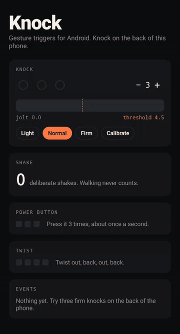
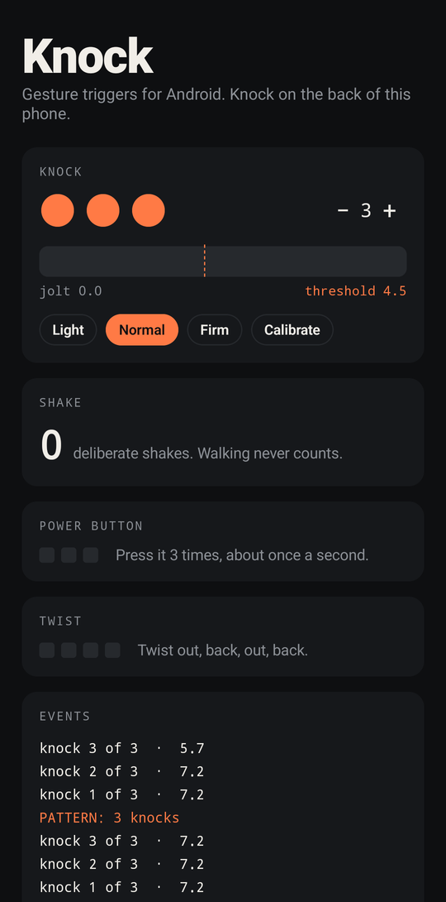
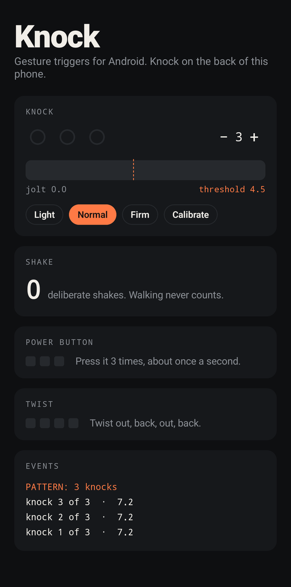

# Knock

**Gesture triggers for Android: knock patterns through a pocket, deliberate shakes, power-button presses and wrist twists, as Kotlin Flows.**

[](https://github.com/AtharvaLakhe/knock/actions/workflows/ci.yml)
[](https://jitpack.io/#AtharvaLakhe/knock)


<table>
<tr>
<td></td>
<td>

```kotlin
Gestures.knocks(context).collect { event ->
    if (event == KnockEvent.Pattern) startSos()
}
```

Three knocks on the back of the phone, even through a pocket with the screen off, and your app reacts.

The detectors come from a women's safety app, [Security4Her](https://security4her.vercel.app), where a false alarm sends texts to someone's family and a missed one is worse. So they are built to say no to everything that isn't deliberate: walking, running, a bump in a bag, a phone dropped on a table, tapping on the screen.

</td>
</tr>
</table>

## Install

Add JitPack to `settings.gradle.kts`:

```kotlin
dependencyResolutionManagement {
    repositories {
        google()
        mavenCentral()
        maven("https://jitpack.io")
    }
}
```

Then the dependency:

```kotlin
dependencies {
    implementation("com.github.AtharvaLakhe:knock:1.0.0")
}
```

No permissions are needed except `WAKE_LOCK`, which the library declares and only uses if you ask it to listen with the screen off.

## Use it

Every gesture is a cold `Flow`: sensors are registered when you start collecting and released when you stop.

```kotlin
lifecycleScope.launch {
    repeatOnLifecycle(Lifecycle.State.STARTED) {
        launch {
            Gestures.knocks(context, KnockConfig(count = 3)).collect { e ->
                when (e) {
                    is KnockEvent.Knock -> buzz()                       // e.index of 3, e.strength
                    is KnockEvent.Soft -> hint("Knock a little harder")
                    is KnockEvent.Rejected -> reset()                   // TooSlow, TooMany, Moving
                    KnockEvent.Pattern -> trigger()
                }
            }
        }
        launch { Gestures.shakes(context).collect { trigger() } }
        launch {
            Gestures.powerPresses(context).collect { if (it == PowerPressEvent.Pattern) trigger() }
        }
        launch {
            Gestures.twists(context).collect { if (it.detected) trigger() }   // needs a gyroscope; great on Wear OS
        }
    }
}
```

### In a pocket, with the screen off

```kotlin
Gestures.knocks(
    context,
    KnockConfig(count = 3, threshold = KnockConfig.NORMAL),
    screenOffOnly = true,   // taps and typing on the screen can never count
    keepCpuAwake = true,    // many phones stop the accelerometer with the screen off
)
```

Collect this inside a foreground service so it keeps running in the background. `keepCpuAwake` holds a partial wake lock while you collect, so only turn it on while a listening feature is switched on.

### Fit it to one person's knock

People knock very differently. Ask for five practice knocks and let the calibrator set the threshold a little below their usual strength:

```kotlin
val strengths = mutableListOf<Float>()
Gestures.knocks(context).collect { e ->
    if (e is KnockEvent.Knock) strengths += e.strength
    if (e is KnockEvent.Soft) strengths += e.strength
    if (strengths.size == 5) saveThreshold(KnockCalibrator.threshold(strengths))
}
```

### Draw a live meter

```kotlin
Gestures.knocks(context, onLevel = { jolt -> meter.value = jolt })
```

## What each gesture listens for

| Gesture | What counts | What never counts |
|---|---|---|
| **Knock** | 2 to 5 sharp knocks, 0.2 to 1.1 s apart, then a pause | Walking, running, a shove or a drop, a fourth knock (a rhythm), light taps on a phone lying on a table |
| **Shake** | 3 jolts over 2.5 g within 2 s | Walking, jogging, one hard bump |
| **Power button** | 3 presses about a second apart | Checking the time, notifications, Android's own fast-press SOS and camera shortcuts |
| **Twist** | Out, back, out, back around one axis | Quick flicks, a swinging arm |

All of it is configurable through `KnockConfig`, `ShakeConfig`, `PowerPressConfig` and `TwistStrength`.

## How knock detection works

A knock is a sudden change in acceleration, so the detector looks at the jump between one reading and the next rather than at the reading itself. Holding a phone, walking or turning it changes little from sample to sample; a knock's hit and ring change a lot.

1. Each jump above the floor opens an 80 ms window, and its peak decides whether it was a knock or too soft.
2. For 200 ms after a knock nothing else counts, and by then the phone has to have settled. A shove or a fall keeps moving; a knock doesn't.
3. The bar rises with ongoing movement, so you can knock while walking but walking alone never adds up.
4. A phone lying flat and dead still is on a hard surface, where even a light tap spikes, so knocks there must be 2.2 times harder, unless the proximity sensor says the screen is covered, which means a pocket.
5. Exactly *n* knocks, then a 0.7 s pause with no extra knock.

It works at any sample rate from 50 to 200 Hz, and the detectors are plain Kotlin with no Android types, so you can unit-test your own patterns by feeding them recorded data:

```kotlin
val detector = KnockDetector(KnockConfig(count = 2)) { event -> println(event) }
recording.forEach { (x, y, z, t) -> detector.feed(x, y, z, t) }
```

The library ships with 44 tests that run synthetic knocks, walking, running, falls, table taps and pocket knocks through every detector at 50, 100 and 200 Hz.

## Sample app

`sample/` shows every gesture live, with a meter, a calibration flow and an event log. Install `knock-sample.apk` from the [latest release](https://github.com/AtharvaLakhe/knock/releases/latest) to try every gesture on your own phone, or build it with `./gradlew :sample:installDebug`.

<p>


</p>

## Good uses

- Safety and emergency apps: a silent trigger from a pocket
- Accessibility: big physical gestures instead of small touch targets
- Hands-busy moments: cooking, cycling, gloves on
- Games and toys that react to being tapped or shaken
- Wear OS shortcuts that work without looking at the watch

## Licence

Apache 2.0. Made by [Atharva Lakhe](https://github.com/AtharvaLakhe).
